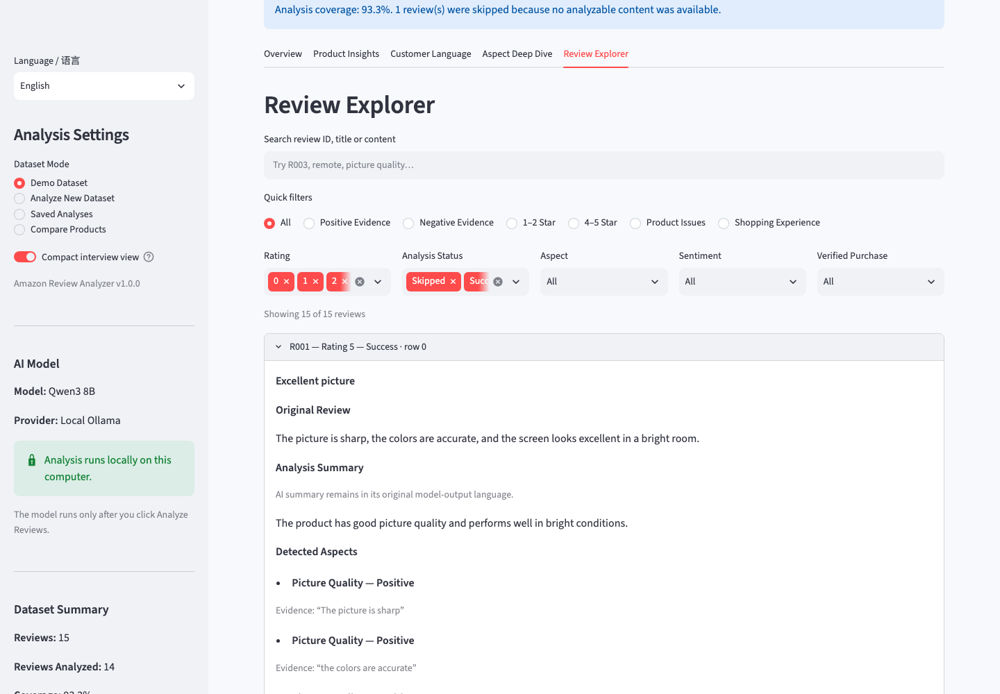
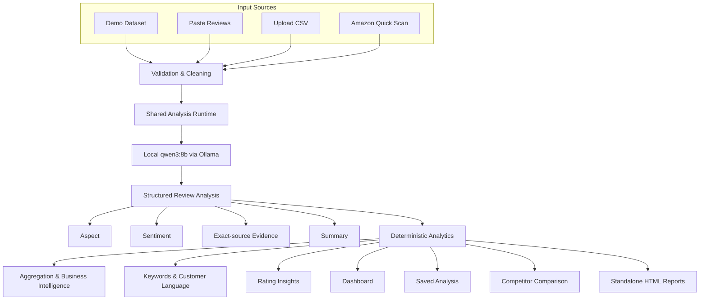

# Amazon Review Analyzer v1.0.1

### Local AI review intelligence for product, customer, and competitor decisions

Turn unstructured e-commerce reviews into aspect-level sentiment, verbatim evidence, customer language, deterministic business insights, and comparison-ready reports—locally on your Mac.

**Built with Python, Streamlit, Ollama, and qwen3:8b.**

[](https://github.com/minghaocao/amazon-review-analyzer/releases/tag/v1.0.1)
[](#requirements)
[](#product-preview)
[](#privacy)
[](#model-evaluation)
[](#testing)
[](#privacy)
[](LICENSE)

**Current stable release: [v1.0.1](https://github.com/minghaocao/amazon-review-analyzer/releases/tag/v1.0.1)**

| Verified signal | Result |
| --- | ---: |
| Blind V2 Aspect + Sentiment F1 | **85.66%** |
| Sentiment Accuracy | **98.33%** |
| Evidence Validity / Match | **100% / 100%** |
| Automated Tests | **1,216 / 1,216** |

> Evaluation metrics refer to the frozen 150-case Blind V2 evaluation set and are not claims of universal model accuracy.

<p align="center">
  <a href="screenshots/01-overview.png">
    
  </a>
</p>
<p align="center"><sub><strong>Overview & Executive Summary</strong> — Headline coverage, validated Evidence, sample-size context, and top product signals in one view.</sub></p>

> **Independent project:** Amazon Review Analyzer is a portfolio/open-source project. It is not affiliated with, endorsed by, or sponsored by Amazon.

## What it does

Amazon Review Analyzer converts raw customer feedback into traceable aspect, sentiment, evidence, keyword, business-intelligence, comparison, and reporting outputs. The local LLM handles semantic interpretation; deterministic Python logic handles validation, counts, rates, rankings, comparisons, and report rendering.

## Why This Project Exists

Star ratings show the outcome, not the reason. Across many mixed reviews, repeated strengths, recurring friction, and the exact language customers use are slow to identify and inconsistent to quantify by hand.

This project turns review text into practical signals:

- what customers like and dislike;
- which product aspects appear most often;
- sentiment by aspect with representative source evidence;
- emerging pain points and product opportunities;
- competitor strengths, weaknesses, and white-space opportunities;
- customer wording that can inform product, listing, and marketing decisions.

The results are decision aids rather than claims of statistical significance, and sample-size context stays visible.

## Product Preview

The screenshots below use the frozen Demo Dataset or previously completed local analyses. They show actual application screens; no synthetic interface mockups were created for this README.

<table>
  <tr>
    <td width="50%" valign="top">
      <strong>Product Insights</strong><br>
      Priority mapping turns review share and sentiment into transparent, directional product signals.<br><br>
      <a href="screenshots/02-product-insights.png"></a>
    </td>
    <td width="50%" valign="top">
      <strong>Aspect Deep Dive</strong><br>
      Aspect-specific language and validated verbatim evidence keep conclusions inspectable.<br><br>
      <a href="screenshots/04-aspect-deep-dive.png"></a>
    </td>
  </tr>
  <tr>
    <td width="50%" valign="top">
      <strong>Review Explorer</strong><br>
      Search and filter each original review, then trace its summary, aspects, sentiment, and evidence.<br><br>
      <a href="screenshots/05-review-explorer.png"></a>
    </td>
    <td width="50%" valign="top">
      <strong>Competitor Comparison</strong><br>
      Compare two compatible saved analyses while preserving sample sizes and evidence limits.<br><br>
      <a href="screenshots/06-competitor-comparison.png"></a>
    </td>
  </tr>
  <tr>
    <td colspan="2" valign="top">
      <strong>Standalone Business Report</strong><br>
      Export an English or Simplified Chinese report that remains viewable and printable without Streamlit.<br><br>
      <a href="screenshots/08-single-product-report.png"></a>
    </td>
  </tr>
</table>

See the [full screenshot tour](screenshots/README.md), including the bilingual interface and comparison report.

## Architecture



Semantic reasoning is isolated behind the local provider layer. Evidence must be a continuous substring of the original review. Counts, rates, eligibility thresholds, business categories, comparisons, integrity checks, and report rendering remain deterministic.

## Features

### Review Intelligence

- multi-aspect extraction and normalized product taxonomy;
- aspect-level positive, negative, neutral, and mixed sentiment;
- exact-source Evidence validation and representative review tracing;
- summaries without replacing the original review;
- per-review handling of repeated and contrasting mentions.

### Business Intelligence

- Executive Summary, Customer Concerns, Selling Points, and Pain Points;
- Opportunity Score and Priority Matrix with visible sample context;
- product-versus-shopping-experience separation;
- rating insights, hidden complaints, and emerging concerns;
- transparent review counts, sentiment counts, and rates.

### Customer Language

- meaningful unigrams, bigrams, and trigrams;
- positive and negative phrases;
- aspect-specific language;
- links from aggregate findings back to original Evidence.

### Competitor Analysis

- deterministic two-product A/B comparison over a canonical 15-aspect view;
- competitive advantages, weaknesses, and white-space opportunities;
- sample-size warnings and side-by-side evidence;
- no new model call when comparing compatible saved analyses.

### Reliability

- per-review checkpointing and resume;
- failed-review-only retry plus one bounded retry for transient provider failures;
- stable single-worker runtime;
- Environment Health Check and Limited Mode;
- integrity-checked local Saved Analyses.

### Product Experience

- English and Simplified Chinese dashboard and reports;
- first-run onboarding and a lightweight macOS launcher;
- standalone single-product and competitor HTML reports;
- local saved-analysis library and Review Explorer.

## Model Evaluation

The final analysis candidate was measured on a frozen Blind V2 dataset that was not used for tuning after its result was revealed.

| Metric | Frozen Blind V2 result |
| --- | ---: |
| Cases | **150** |
| Gold aspect mentions | **271** |
| Aspect + Sentiment Precision | **84.29%** |
| Aspect + Sentiment Recall | **87.08%** |
| Aspect + Sentiment F1 | **85.66%** |
| Aspect-only F1 | **87.11%** |
| Sentiment Accuracy | **98.33%** |
| Evidence Validity | **100%** |
| Evidence Match | **100%** |
| Strict Exact Case Accuracy | **66.67%** |

**Aspect + Sentiment F1 = 85.66% on the frozen 150-case Blind V2 evaluation.**

These values describe performance on that frozen dataset. They should not be interpreted as universal accuracy across all Amazon products, languages, review styles, or categories. In particular, Delivery and `Other` boundaries, exact mention granularity, and Amazon input availability remain measured system boundaries. **不应表述为通用准确率。**

## Example Workflow

```text
Customer Reviews
      ↓
Local AI Analysis
      ↓
Aspect + Sentiment + Evidence
      ↓
Deterministic Aggregation
      ↓
Business Insights
      ↓
Dashboard / Comparison / Report
```

Illustrative input:

> “The picture looks great, but the remote feels cheap and the menus are slow.”

Illustrative structured concepts:

- Picture Quality → Positive
- Remote Control → Negative
- System Performance → Negative

This is an explanatory example, not a reported evaluation case.

## Privacy

**Local-first by default.**

- Default AI inference runs locally through Ollama with `qwen3:8b`.
- No OpenAI API or OpenAI API key is required for the default configuration.
- User review data, checkpoints, Saved Analyses, comparisons, and reports stay local by default.
- The public repository and release package exclude credentials, cookies, browser profiles, `.env`, and user datasets.
- Reports escape dynamic HTML content; this reduces injection risk without making an absolute security claim.

`qwen3:8b` 通过本机 Ollama 推理。Saved Analyses、comparisons 和 reports 均存储在本机项目目录。Amazon Browser Import 会访问 Amazon 网站，但不会把本地 Ollama 推理切换到云端。

## Input Methods

| Mode | Best for | New local inference? |
| --- | --- | --- |
| Demo Dataset | Exploring the product with frozen offline results | No |
| Paste Reviews | Quick manual review analysis | Yes |
| Upload Dataset | Batch CSV analysis | Yes |
| Amazon Quick Scan | Best-effort browser-assisted Amazon review import | Yes |
| Saved Analyses | Reopening completed, integrity-checked analyses | No |
| Competitor Comparison | Comparing two compatible saved analyses | No |

## Amazon Quick Scan limitations

Amazon Quick Scan is a convenience input method, not guaranteed scraping infrastructure. **Amazon may require login or limit automated access.** Amazon may also request manual verification, change page structure, restrict visible review pages, or expose fewer reviews than the displayed total.

The application:

- analyzes only reviews accessible in the current visible browser session;
- does **not** bypass CAPTCHA, login, anti-bot controls, or other access restrictions;
- does not guarantee full or stable review retrieval;
- treats Paste Reviews and Upload Dataset as official fallback paths.

不承诺稳定获取商品的全部评论，也不绕过 CAPTCHA、登录要求或 Amazon 访问控制。

## Saved Analyses

Completed analyses can be saved as local, integrity-checked snapshots and reopened without rerunning the model. User-specific snapshots are runtime data and are excluded from the publication-ready Git file set.

## Competitor Comparison

Two compatible Saved Analyses can be compared without rerunning the model. Differences remain directional: the interface preserves sample sizes, evidence levels, and insufficient-evidence states rather than declaring a universal winner.

## Report Export

Single-product and competitor reports export as standalone English or Simplified Chinese HTML. Presentation assets are embedded, dynamic content is escaped, and the finished file can be opened or printed from Chrome without a Streamlit connection. Curated examples are available in [`sample_reports/`](sample_reports/README.md).

## Installation

The README keeps setup intentionally short. Use the linked Quick Start for step-by-step installation and the full User Guide for recovery and platform details.

## Requirements

- compatible macOS (the validated desktop environment);
- Python 3.11 or newer;
- [Ollama](https://ollama.com/download/mac);
- local `qwen3:8b`;
- dependencies in `requirements.txt`.

The bundled `.app` is a lightweight, unsigned, non-notarized launcher. It depends on this project and its local Python/Ollama environment; it is not a fully self-contained AI binary.

## Quick Start

1. Clone or download this repository.
2. Install Ollama, then install the local model with `ollama pull qwen3:8b`.
3. Double-click `setup_amazon_review_analyzer.command` to create and validate the project environment.
4. Open `dist/Amazon Review Analyzer.app`, or launch manually:

```bash
source .venv/bin/activate
streamlit run app.py
```

The local dashboard opens at `http://localhost:8501`. Start with the Demo Dataset; it does not require a new model call.

Detailed setup:

- [Quick Start — English](QUICK_START_EN.md)
- [快速开始 — 中文](QUICK_START_CN.md)
- [User Guide — English](docs/Amazon_Review_Analyzer_v1.0.1_User_Guide_EN.md)
- [用户指南 — 中文](docs/Amazon_Review_Analyzer_v1.0_User_Guide_CN.md)

## One-click launcher

The optional desktop launcher is installed as `~/Desktop/Amazon Review Analyzer.command`. It activates the local environment, checks Ollama without downloading a model, starts or reuses the Streamlit instance, and opens the dashboard.

**Stable mode / 1 worker** is the validated default. To stop a dashboard started from the launcher, return to its Terminal window and press `Ctrl+C`（在 Terminal 中按 `Ctrl+C`）。

## English / 中文

The dashboard, onboarding, diagnostics, and reports support English and Simplified Chinese. Localization affects presentation only: canonical aspect names, sentiment values, CSV columns, and JSON keys stay stable, while original reviews and Evidence are not silently translated.

## Project Structure

```text
amazon-review-analyzer/
├── app.py
├── review_analyzer.py
├── llm_client.py
├── aspect_taxonomy.py
├── batch_analyzer.py
├── aggregator.py
├── keyword_analyzer.py
├── business_intelligence.py
├── analysis_library.py
├── competitor_comparison.py
├── report_generator.py
├── analysis_runtime.py
├── docs/
├── screenshots/
├── sample_data/
├── sample_reports/
└── tests/
```

## Engineering Highlights

- local LLM provider abstraction with schema-constrained structured output;
- exact-substring Evidence validation with partial-failure isolation;
- frozen evaluation methodology and explicit dataset-scoped metrics;
- checkpoint/resume, failed-only retry, and bounded transient-provider recovery;
- deterministic aggregation, business rules, and competitor comparison;
- bilingual UI with stable canonical data keys;
- persistent Saved Analysis snapshots with integrity checks;
- standalone report generation, release-health checks, and privacy-safe packaging.

## What This Project Demonstrates

- translating an e-commerce problem into an inspectable AI/data product;
- integrating and evaluating a local LLM;
- building source-grounded aspect-based sentiment analysis;
- converting NLP outputs into transparent business analytics;
- designing resilient batch workflows and deterministic downstream logic;
- productizing, testing, documenting, and packaging a bilingual local application.

For the development story, design decisions, evaluation methodology, and lessons learned, read the **[Portfolio Case Study](docs/PORTFOLIO_CASE_STUDY.md)**. A concise, reusable project overview is available in the **[Portfolio Summary](PORTFOLIO_SUMMARY.md)**.

## Testing

The v1.0.1 publication baseline passed **1,216 / 1,216 automated tests**. Routine tests use mocks and local fixtures: they do not access Amazon, call OpenAI, perform real Ollama inference, or rerun frozen evaluations.

```bash
source .venv/bin/activate
python -m unittest discover -s tests -v
python main.py --release-health-check
```

Release Health also validates frozen asset hashes, localization coverage, launcher readiness, package integrity, and publication safety.

## Documentation

- [Quick Start — English](QUICK_START_EN.md)
- [快速开始 — 中文](QUICK_START_CN.md)
- [User Guide — English](docs/Amazon_Review_Analyzer_v1.0.1_User_Guide_EN.md)
- [用户指南 — 中文](docs/Amazon_Review_Analyzer_v1.0_User_Guide_CN.md)
- [System Overview](SYSTEM_OVERVIEW.md)
- [Portfolio Case Study](docs/PORTFOLIO_CASE_STUDY.md)
- [Portfolio Summary](PORTFOLIO_SUMMARY.md)
- [Release Notes v1.0.1](RELEASE_NOTES_v1.0.1.md)
- [Changelog](CHANGELOG.md)
- [Screenshot Index](screenshots/README.md)
- [GitHub Portfolio Setup](GITHUB_PORTFOLIO_SETUP.md)

## Known Limitations

- Amazon review availability depends on Amazon login, verification, access controls, page structure, and session state.
- Quick Scan cannot guarantee full review retrieval.
- Local inference speed depends on Mac hardware, review length, and model warm-up state.
- Ollama and `qwen3:8b` are required for new AI analysis.
- The current macOS `.app` is a launcher, not a completely self-contained binary.
- The application is local-first rather than cloud-hosted.
- v1.0.1 supports two-product A/B comparison rather than a multi-product matrix.
- Evaluation metrics are specific to the frozen datasets on which they were measured.
- The fixed aspect taxonomy may map category-specific details to `Other`.

## Troubleshooting

- Run `python main.py --health-check` to inspect Python, dependencies, Ollama, the local model, and launcher readiness without starting analysis.
- If Ollama or `qwen3:8b` is unavailable, the Demo Dataset and existing results remain available in Limited Mode.
- If port 8501 already hosts this project, the launcher reuses the verified instance; it does not stop unrelated processes.
- Use the bundled Safe Stop helper for a verified background instance, or press `Ctrl+C` in the Terminal that started Streamlit.

## Project Status

**v1.0.1 — Stable local release**

This is a portfolio/research release, not a claim of commercial production deployment.

## Disclaimer

Amazon Review Analyzer is an independent portfolio/open-source project and is not affiliated with, endorsed by, or sponsored by Amazon. Amazon and related trademarks belong to their respective owners. Users are responsible for complying with applicable platform terms and policies.

## License

Available under the [MIT License](LICENSE).
