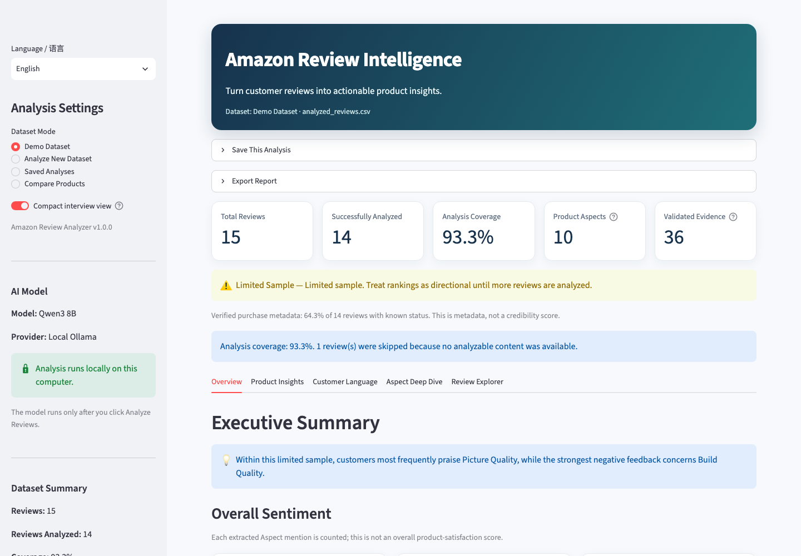
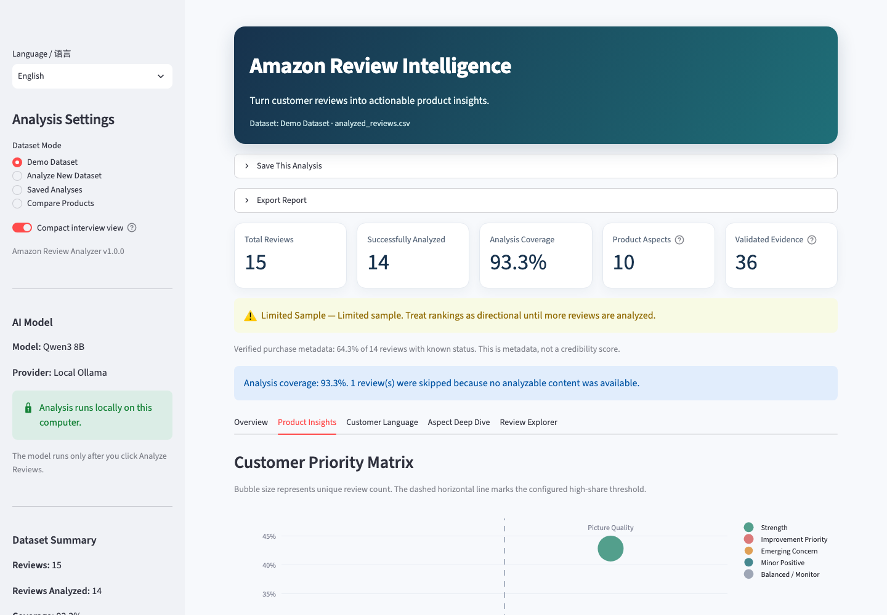
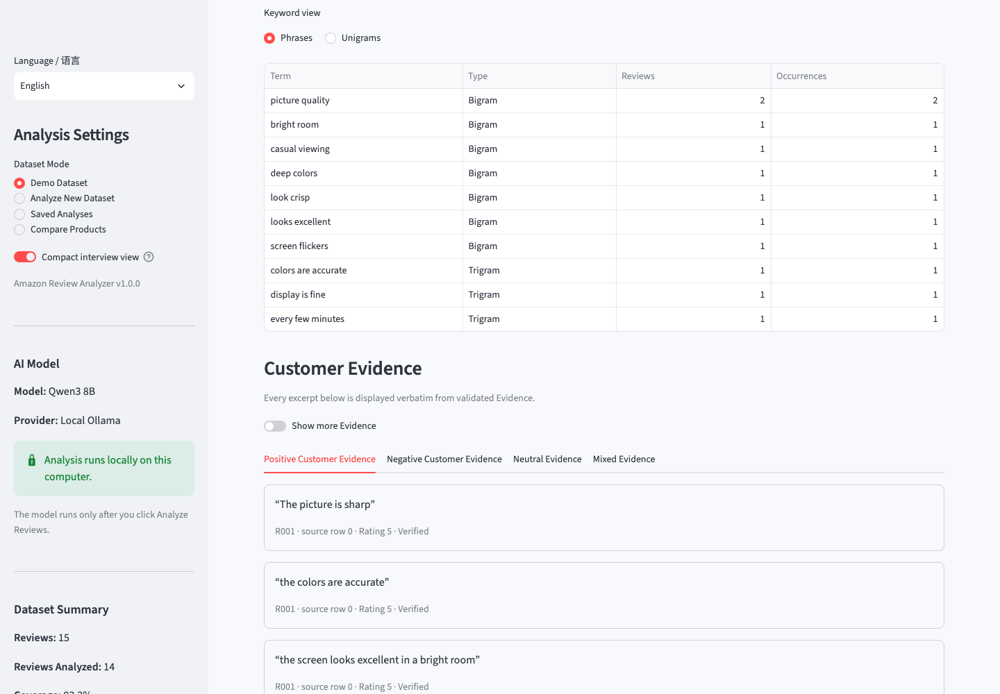
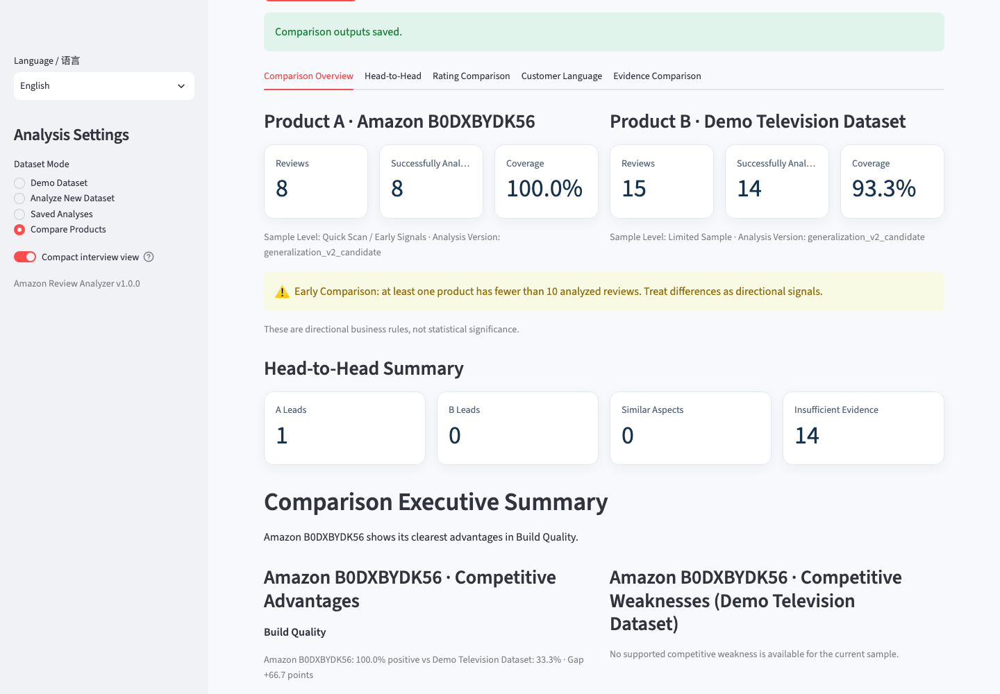
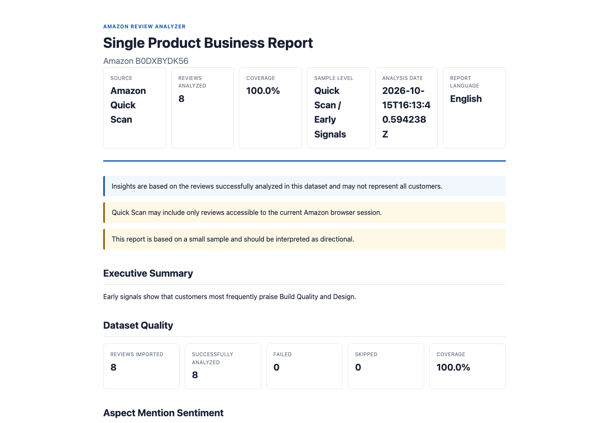
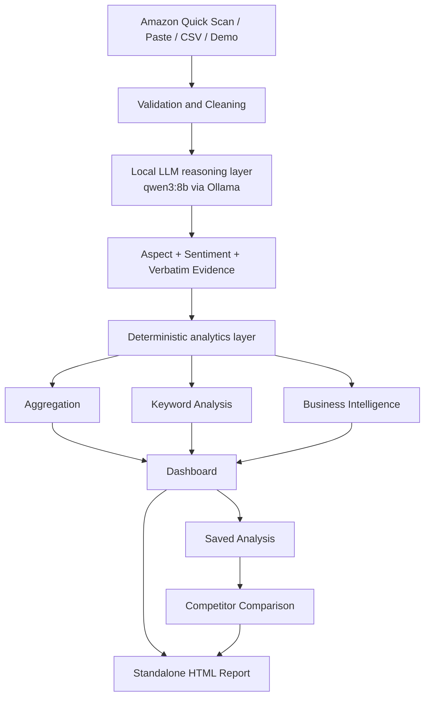

# Amazon Review Analyzer v1.0.1

**Local AI-powered review intelligence for turning Amazon customer feedback into actionable product, customer, and competitor insights.**

[](#project-status)
[](#ai-architecture)
[](#testing)

Amazon Review Analyzer transforms unstructured product reviews into traceable aspect, sentiment, evidence, keyword, and business-intelligence outputs. It runs locally on macOS, supports English and Simplified Chinese, and includes saved analyses, two-product comparison, and standalone HTML reports.

> **Disclaimer:** Amazon Review Analyzer is an independent portfolio/research project and is not affiliated with or endorsed by Amazon.

## What it does

The application turns individual review comments into traceable aspect, sentiment, evidence, keyword, and business-intelligence outputs, then presents those results in a dashboard, saved analysis, comparison, or standalone report.

## Product Preview

| Overview | Product Insights |
| --- | --- |
| [](screenshots/01-overview.png) | [](screenshots/02-product-insights.png) |

| Aspect Deep Dive | Competitor Comparison |
| --- | --- |
| [](screenshots/04-aspect-deep-dive.png) | [](screenshots/06-competitor-comparison.png) |

| Standalone Report |
| --- |
| [](screenshots/08-single-product-report.png) |

See the [screenshot index](screenshots/README.md) for the full curated product tour.

## Why I Built This

Customer reviews contain signals about product quality, unmet needs, buying language, and shopping experience, but those signals are difficult to extract consistently by hand. This project converts review text into structured, evidence-grounded intelligence:

- product strengths and customer pain points;
- sentiment by product aspect;
- representative verbatim evidence;
- customer keywords and phrases;
- competitive advantages, weaknesses, and white-space opportunities;
- product-experience versus shopping-experience issues.

The goal is not to replace product judgment. It is to make review evidence easier to inspect, compare, and act on.

## Features

| Area | Capabilities |
| --- | --- |
| Inputs | Amazon Quick Scan, Paste Reviews, Upload Dataset, frozen Demo Dataset |
| Review intelligence | Aspect extraction, aspect-level sentiment, validated evidence, summaries |
| Business insights | Customer concerns, selling points, pain points, opportunity ranking, rating insights |
| Customer language | Meaningful keywords, positive and negative phrases, aspect-specific language |
| Exploration | Overview, Product Insights, Customer Language, Aspect Deep Dive, Review Explorer |
| Reuse | Local Saved Analyses, integrity checks, deterministic two-product comparison |
| Reporting | Standalone English and Simplified Chinese HTML reports |
| Reliability | Per-review checkpoints, resume, failed-review retry, bounded provider retry |
| Productization | Bilingual UI, first-run onboarding, Environment Health, Limited Mode, diagnostics |
| macOS | Lightweight `.app` launcher, install helper, safe stop, single-instance handling |

## System Architecture



The LLM is used only where semantic interpretation is required. Counts, rates, ranking eligibility, business categories, comparisons, integrity checks, and report rendering are deterministic Python logic. Evidence must be a continuous substring of the original review, keeping conclusions auditable.

## AI Architecture

- **Provider:** Ollama
- **Model:** `qwen3:8b`
- **Default runtime:** stable serial processing with 1 worker
- **Context:** optimized for individual review analysis

Local inference was chosen for privacy, no per-request API cost, repeatable evaluation, offline analysis, and a portfolio-friendly architecture that can be inspected end to end. It is not presented as instant: runtime depends on hardware, review length, and model state.

The 1-worker default is deliberate. On the frozen benchmark and current 16 GiB Mac environment, two concurrent workers reduced throughput and increased latency, so the stable configuration prioritizes predictable execution over nominal concurrency.

## Evaluation

Evaluation data was separated from optimization data and frozen before final measurement to reduce leakage. On the **frozen 150-case Blind V2 evaluation set**:

| Metric | Result |
| --- | ---: |
| Aspect + Sentiment F1 | **85.66%** |
| Aspect-only F1 | **87.11%** |
| Sentiment Accuracy | **98.33%** |
| Evidence Validity | **100%** |
| Evidence Match | **100%** |

These metrics apply only to the frozen Blind V2 evaluation set and do not represent universal accuracy. They should not be summarized as “the app is 85.66% accurate.” Performance can vary across product categories, languages, writing styles, and sample quality.

Aspect + Sentiment F1 = 85.66% on the frozen 150-case Blind V2 evaluation. 该结果仅适用于冻结评估集，不应表述为通用准确率。

## Business Intelligence

The deterministic business layer derives transparent signals from completed review analyses:

- review share and sentiment distribution;
- product selling points and pain points;
- opportunity score and priority matrix;
- rating insights and hidden complaints;
- product versus shopping-experience separation;
- representative evidence and sample-size context.

These outputs are directional decision aids, not claims of statistical significance. Small samples are labeled accordingly, and formal rankings require a configurable minimum number of reviews.

## Saved Analyses

Completed analyses can be stored as local, integrity-checked snapshots. They can be reopened, compared, or used for report generation without rerunning the model. User-specific snapshots are local runtime data and are excluded from the publication-ready Git file set.

## Competitor Comparison

Two previously analyzed products can be compared without rerunning the model. The comparison includes head-to-head aspect coverage, sentiment differences, advantages, weaknesses, white-space opportunities, rating context, customer language, and side-by-side evidence.

The system does not declare a universal winner. It preserves sample sizes and evidence levels so users can judge whether the underlying datasets are comparable.

## Report Export

Existing analyses and comparisons can be exported as standalone English or Simplified Chinese HTML reports. Reports embed their presentation assets, escape dynamic content, and do not call the model during generation. Curated examples are available in [`sample_reports/`](sample_reports/README.md).

## Requirements

- macOS (the currently validated desktop environment)
- Python 3.11+
- [Ollama](https://ollama.com/download/mac)
- local `qwen3:8b`
- project dependencies from `requirements.txt`

## Quick Start

Recommended first run:

1. Double-click `setup_amazon_review_analyzer.command`.
2. Confirm Ollama is running and `qwen3:8b` is installed.
3. Open `dist/Amazon Review Analyzer.app`.
4. Start with the Demo Dataset.

The app opens its local Streamlit interface at `http://localhost:8501`. The `.app` is a lightweight launcher: it is unsigned, not notarized, and depends on the project’s local Python/Ollama environment. It is **not** a fully self-contained binary.

Detailed setup:

- [English Quick Start](QUICK_START_EN.md)
- [中文快速开始](QUICK_START_CN.md)
- [English User Guide](docs/Amazon_Review_Analyzer_v1.0.1_User_Guide_EN.md)
- [中文用户指南](docs/Amazon_Review_Analyzer_v1.0_User_Guide_CN.md)

Manual launch:

```bash
source .venv/bin/activate
streamlit run app.py
```

## One-click launcher

The optional desktop launcher is installed as `~/Desktop/Amazon Review Analyzer.command`. It activates the local environment, checks Ollama without downloading a model, starts or reuses the Streamlit instance, and opens the local dashboard. Stable mode / 1 worker is the validated default. To stop a dashboard started from the launcher, return to its Terminal window and press `Ctrl+C`（在 Terminal 中按 `Ctrl+C`）。

## English / 中文

The dashboard, onboarding, diagnostics, and reports support English and Simplified Chinese. Localization affects presentation only: canonical aspect names, sentiment values, CSV columns, and JSON keys remain stable, while original review text and evidence are not silently translated.

## Input Methods

- **Demo Dataset:** frozen synthetic data for a stable, offline product tour.
- **Paste Reviews:** paste one review per line, preview, then analyze locally.
- **Upload Dataset:** map CSV columns to the standard review schema.
- **Amazon Quick Scan:** import only reviews accessible in the current visible browser session.
- **Saved Analyses:** reopen integrity-checked local snapshots.
- **Competitor Comparison:** compare two compatible saved analyses using existing outputs.

## Amazon Quick Scan limitations

Amazon may require login or limit automated access. Amazon may also request human verification or restrict visible review pages. The application:

- does not bypass CAPTCHA, login, anti-bot controls, or session restrictions;
- analyzes only reviews accessible to the current browsing session;
- may retrieve fewer reviews than exist on a product page;
- provides Paste Reviews and Upload Dataset as official fallback methods.

This is an access constraint, not a promise of exhaustive Amazon review collection.

不承诺稳定获取商品的全部评论，也不绕过 CAPTCHA、登录要求或 Amazon 访问控制。

## Privacy

- Model inference occurs locally through Ollama.
- OpenAI is not required in the default configuration.
- Reviews, checkpoints, saved analyses, comparisons, and reports remain local by default.
- Diagnostics intentionally record operational metadata rather than full review text.
- Release and publication packages exclude credentials, cookies, browser profiles, `.env`, and user datasets.

`qwen3:8b` 通过本机 Ollama 推理。Saved Analyses、comparisons 和 reports 均存储在本机项目目录。Amazon Browser Import 会访问 Amazon 网站，但不会把本地 Ollama 推理切换到云端。

## Testing

The v1.0.1 publication baseline passed **1,216 / 1,216 automated tests**. The test and release process also includes:

- offline Release Health checks;
- frozen-asset SHA-256 validation;
- localization coverage checks;
- launcher and single-instance smoke tests;
- package integrity and security scans.

Routine tests use mocks and local fixtures; they do not call Amazon, OpenAI, or real Ollama inference, and they do not rerun frozen evaluations.

```bash
source .venv/bin/activate
python -m unittest discover -s tests -v
python main.py --release-health-check
```

## Known Limitations

- Amazon access can be limited by login, verification, website changes, and session state.
- `qwen3:8b` inference speed depends on Mac hardware and model warm-up state.
- New analysis requires a configured Python environment, Ollama, and the local model.
- The macOS `.app` is unsigned, not notarized, and not self-contained.
- Competitor comparison currently supports two products.
- Business signals are directional; small datasets reduce confidence.
- The fixed aspect taxonomy may map category-specific details to `Other`.

## Troubleshooting

- Run `python main.py --health-check` to inspect Python, dependencies, Ollama, the local model, and launcher readiness without starting analysis.
- If Ollama or `qwen3:8b` is unavailable, the Demo Dataset and existing results remain available in Limited Mode.
- If port 8501 is already occupied by this project, the launcher reuses the verified instance; it does not kill unrelated processes.
- Use the bundled Safe Stop helper for a verified background instance, or press `Ctrl+C` in the Terminal that started Streamlit.

## Technology Stack

Python, Streamlit, Ollama, qwen3:8b, pandas, Plotly, Pydantic, Playwright, local file-based persistence, standalone HTML/CSS report export, and Python `unittest`.

## Project Documentation

- [Portfolio Case Study](docs/PORTFOLIO_CASE_STUDY.md)
- [Reusable Portfolio Summary](docs/PORTFOLIO_SUMMARY.md)
- [System Overview](SYSTEM_OVERVIEW.md)
- [Release Notes](RELEASE_NOTES_v1.0.1.md)
- [License Decision Guide](docs/LICENSE_OPTIONS.md)
- [GitHub Publication Checklist](docs/GITHUB_PUBLICATION_CHECKLIST.md)

## Project Status

**v1.0.1 — Stable local release**

This is a portfolio/research release, not a claim of commercial production deployment. The project demonstrates local AI application design, evidence-grounded NLP, deterministic analytics, e-commerce product thinking, evaluation discipline, and desktop productization.

## License

This project is available under the [MIT License](LICENSE).
