# Amazon Review Analyzer

## AI-powered Review Intelligence & Competitive Analysis

**版本：v1.0.0** · **发布状态：Stable Release**

**产品定位：基于本地大语言模型的商品评论分析、商业洞察与竞品比较工具**

Amazon Review Analyzer 将消费者原始评论转换为可追溯的 **Aspect、Sentiment、Evidence、Customer Language、Business Insights、Competitor Comparison** 和可导出的独立报告。系统默认使用本机 Ollama 与 `qwen3:8b` 推理，分析结果、历史快照与报告均保存在本地。

| 发布验收项 | 状态 |
| --- | --- |
| Product Release Acceptance | **PASS** |
| Automated Tests | **1077 / 1077 passed** |
| BLOCKER | **0** |
| MAJOR | **0** |

> **说明**：自动测试数量用于说明软件工程验证范围，不代表模型准确率。模型质量指标见“模型质量与评估”。

### 核心特性

- **Local AI**：默认在本机通过 Ollama 运行 `qwen3:8b`。
- **Evidence-grounded**：每个分析结论可回到评论原文证据。
- **Bilingual**：Dashboard 与报告支持 English / 简体中文。
- **Saved Analysis**：分析可保存为带 SHA-256 完整性检查的本地快照。
- **Competitive Intelligence**：支持两款商品的标准化 Aspect 对比。
- **Standalone Reports**：可导出无需 Python、Streamlit 或网络的独立 HTML 报告。

---

## 目录

1. [系统简介](#section-1)
2. [系统运行环境](#section-2)
3. [启动系统](#section-3)
4. [English / 简体中文](#section-4)
5. [数据输入方式](#section-5)
6. [AI Review Analysis](#section-6)
7. [Dashboard](#section-7)
8. [Business Intelligence](#section-8)
9. [Analysis Library](#section-9)
10. [Competitor Comparison](#section-10)
11. [Business Reports](#section-11)
12. [Runtime & Reliability](#section-12)
13. [Performance](#section-13)
14. [Model Quality & Evaluation](#section-14)
15. [Privacy & Data](#section-15)
16. [Known Limitations](#section-16)
17. [Frequently Asked Questions](#section-17)
18. [Troubleshooting](#section-18)
19. [Glossary](#section-19)
20. [Recommended Workflow](#section-20)
21. [Best Practices](#section-21)
22. [Version Information](#section-22)
23. [附录 A — Technical Architecture](#appendix-a)
24. [附录 B — Data & Output Structure](#appendix-b)
25. [附录 C — v1.0 Release Validation](#appendix-c)

---

<a id="section-1"></a>
## 1. 系统简介

### 1.1 解决的问题

电商评论通常数量多、表达方式不统一，而且同一条评论可能同时包含优点、缺点、物流体验和售后反馈。仅看平均星级或简单词频，难以回答以下问题：

- 消费者最关心产品的哪些方面？
- 哪些优势被不同顾客反复认可？
- 哪些问题影响产品体验，哪些只是购物体验问题？
- 结论能否追溯到顾客原话？
- 两款商品在相同评价维度上有何差异？

Amazon Review Analyzer 将评论逐条结构化，再通过确定性的聚合规则形成商业洞察。它不是简单的整条评论正负面分类器，也不是只统计 `good`、`product` 等通用词的词频工具。

### 1.2 端到端流程

```mermaid
flowchart LR
    A[Demo / Amazon Quick Scan / CSV / Paste] --> B[Validation & Cleaner]
    B --> C[Local qwen3:8b]
    C --> D[Aspect + Sentiment + Evidence]
    D --> E[Aggregator + Keyword Analyzer]
    E --> F[Business Intelligence]
    F --> G[Dashboard]
    G --> H[Saved Analysis]
    H --> I[Competitor Comparison]
    I --> J[Standalone HTML Report]
```



纯文本回退表示：

```text
Reviews
→ Validation & Cleaning
→ Local AI Analysis
→ Structured Evidence
→ Business Intelligence
→ Dashboard
→ Saved Analysis
→ Competitor Comparison
→ Business Report
```

### 1.3 核心能力概览

| 模块 | 当前能力 |
| --- | --- |
| Review Input | Demo Dataset、Amazon Quick Scan、CSV Upload、Paste Reviews |
| AI Analysis | Summary、Aspect、Aspect-level Sentiment、原文 Evidence |
| Business Intelligence | Selling Points、Pain Points、Opportunity Ranking、Priority Matrix、Rating Insights |
| Customer Language | unigram、bigram、trigram、正负短语、Aspect-specific language |
| Dashboard | Overview、Product Insights、Customer Language、Aspect Deep Dive、Review Explorer |
| Saved Analysis | 本地持久化快照、版本兼容检查、SHA-256 完整性校验 |
| Competitor Comparison | Product A vs Product B、固定 15 Aspect 对齐、Evidence 对比 |
| Reports | 单商品与竞品对比的 English / 中文独立 HTML 报告 |
| Localization | English / 简体中文展示层切换 |
| Runtime | Stable 1-worker、Progress、ETA、Checkpoint、Resume、Retry Failed Reviews |

---

<a id="section-2"></a>
## 2. 系统运行环境

### 2.1 已验证环境

v1.0.0 的正式桌面验收环境为 macOS。本次发布环境使用：

| 组件 | 当前发布信息 |
| --- | --- |
| Operating System | macOS |
| Python | 3.13.14（项目建议 Python 3.11 或更高版本） |
| Local AI runtime | Ollama 0.34.2 |
| Default model | `qwen3:8b` |
| Web UI | Streamlit 1.64.0（项目约束 `>=1.50,<2`） |
| Data processing | pandas 3.0.6（项目要求 `>=2.2`） |
| Amazon browser import | Playwright 1.63.0 + Chromium |

### 2.2 资源建议

- 为 Python 虚拟环境、Playwright Chromium 和本地模型预留约 10 GB 或以上磁盘空间。
- `qwen3:8b` 适合在具备足够内存的本地设备上运行；发布验收设备为 16 GiB Apple Silicon Mac。
- Demo Dashboard、Saved Analyses 和已生成报告不依赖实时模型；只有分析新评论时需要 Ollama 与模型。
- Amazon Quick Scan 还需要网络和普通可见 Chromium，但不会自动绕过 Amazon 的访问控制。

> **Tip**：面试或演示前先启动 Ollama，并确认 `qwen3:8b` 已在本地，以减少首次分析的冷启动时间。

---

<a id="section-3"></a>
## 3. 启动系统

### 3.1 推荐方式：macOS 桌面启动器

双击桌面的：

```text
~/Desktop/Amazon Review Analyzer.command
```

启动器会依次：

1. 进入项目目录并激活 `.venv`。
2. 检查 Ollama 命令与本地服务。
3. Ollama 已安装但未运行时，有限次尝试打开 Ollama 应用。
4. 检查本地是否存在 `qwen3:8b`，但不会自动下载大型模型。
5. 检查本项目的 Streamlit 是否已经运行；若已运行，只打开已有页面。
6. 启动 Dashboard，并在浏览器打开 `http://localhost:8501`。

即使 Ollama 未安装、未运行或模型不存在，启动器仍会打开 Demo Dashboard；此时仅“新 AI 分析”暂不可用。

在启动器 Terminal 窗口按 `Ctrl+C` 会停止本次启动的 Streamlit，不会删除数据、checkpoint 或快照，也不会停止 Ollama。

> **macOS 安全提示**：首次运行若被系统拦截，可在 Finder 中右键该文件并选择“打开”。不要关闭系统安全检查。

### 3.2 手动启动

在项目父目录打开 Terminal：

```bash
cd amazon_review_analyzer
source .venv/bin/activate
streamlit run app.py
```

浏览器通常会自动打开。若没有自动打开，请访问：

```text
http://localhost:8501
```

### 3.3 首次环境准备

仅在虚拟环境尚未创建时执行：

```bash
cd amazon_review_analyzer
python3 -m venv .venv
source .venv/bin/activate
python -m pip install -r requirements.txt
cp .env.example .env
ollama pull qwen3:8b
python main.py --check-ollama
```

如需使用 Amazon Quick Scan，再安装 Chromium runtime：

```bash
playwright install chromium
```

启动应用本身不会自动分析评论，也不会自动访问 Amazon。

---

<a id="section-4"></a>
## 4. English / 简体中文

侧边栏顶部的 **Language / 语言** 支持：

- English
- 简体中文

语言切换属于展示层操作：

- 不会调用 Ollama。
- 不会重新分析、重新聚合或重新生成关键词。
- 不会改变当前 Dataset Mode 或已完成结果。
- 不会修改原始评论、Evidence、canonical Aspect、CSV 列名或 JSON key。
- Original Review、Evidence 与 Customer Language 始终保留原语言。
- 报告语言可与 Dashboard 语言分别选择。

这保证了中英文界面共享同一份底层结果，且原始证据不会因翻译而失真。

---

<a id="section-5"></a>
## 5. 数据输入方式

侧边栏 **Dataset Mode** 提供四个顶层工作区：

1. **Demo Dataset**
2. **Analyze New Dataset**
3. **Saved Analyses**
4. **Compare Products**

其中 **Amazon Quick Scan、Upload Dataset、Paste Reviews** 是 **Analyze New Dataset** 内的三个输入源，而不是三个额外的顶层模式。

### 5.1 Demo Dataset

Demo Dataset 是应用启动后的默认数据，用于体验系统、查看所有 Dashboard 页面和进行稳定演示。

| 指标 | 冻结值 |
| --- | ---: |
| Total Reviews | 15 |
| Successfully Analyzed | 14 |
| Skipped | 1 |
| Coverage | 93.3% |

Demo 为冻结数据，不需要 Ollama 或网络。分析新数据、Amazon 导入、Comparison 或 Report Export 都不会覆盖它。

### 5.2 Paste Reviews

路径：**Analyze New Dataset → Paste Reviews**。

- 每个非空行被视为一条独立评论。
- 空行会被忽略。
- 系统自动生成 `PASTE_0001`、`PASTE_0002` 等 Review ID。
- 预览、验证和清洗完成后，用户点击 **Analyze Reviews** 才会调用模型。
- 分析完成后选择 **View Results** 进入当前结果。

> **注意**：如果一条评论本身含有换行，请先把它整理成一行；否则每一行会被识别成不同评论。

适用场景：少量快速测试、Amazon 访问受限时的替代方式、访谈文本或其他合法评论来源。

### 5.3 Upload Dataset

路径：**Analyze New Dataset → Upload Dataset**。

界面接受最大 10 MiB 的 CSV，尝试使用 UTF-8-SIG、UTF-8 和 CP1252 解码。上传后通过 **Column Mapping** 将用户列映射到标准字段。

| 标准字段 | UI 要求 | 说明 |
| --- | --- | --- |
| `content` | **必需** | 对应 **Review Content**；评论正文 |
| `review_id` | 可选 | 缺失或为空时生成 `UPLOAD_0001` 等稳定 ID |
| `rating` | 可选 | 有值时应可转换为 1–5；缺失时相关评分洞察隐藏 |
| `title` | 可选 | 空标题允许 |
| `date` | 可选 | 保留输入值 |
| `verified_purchase` | 可选 | 仅作为 metadata，不是可信度分数 |

交互式导入最终统一为六列：

```text
review_id, rating, title, content, date, verified_purchase
```

缺少可选列不会让整个文件失败；单行正文为空时会在 Cleaner 阶段标记为不可分析。界面不会因为内部兼容代码而自动截断为 50 条，当前 Upload / Paste 会处理用户确认的完整数据集。

### 5.4 Amazon Quick Scan

路径：**Analyze New Dataset → Amazon Quick Scan**。

标准流程：

1. 在 **Amazon Product URL** 输入商品或评论页面 URL。
2. 点击 **Open Amazon Product**，打开普通可见 Chromium。
3. 如果 Amazon 要求登录或人工验证，由用户本人在浏览器中完成，然后点击 **Continue After Verification**；也可选择 **Cancel Amazon Import**。
4. 点击 **Scan Available Reviews**，读取当前浏览器会话可访问的评论。
5. 在 **Review Preview** 检查 `review_id`、`rating`、`title`、`content`、`date` 和 `verified_purchase`。此时不会调用模型。
6. 确认后点击 **Analyze Available Reviews**，才会保存 Amazon 原始评论并开始本地分析。

Quick Scan 使用有界扫描：最多检查 3 页并保留最多 100 条唯一评论。这是安全上限，不是“保证获得 100 条”。

#### 支持的 marketplace

- `amazon.com`
- `amazon.co.uk`
- `amazon.de`
- `amazon.fr`
- `amazon.it`
- `amazon.es`

#### 支持的 URL path

- `/dp/{ASIN}`
- `/gp/product/{ASIN}`
- `/gp/aw/d/{ASIN}`
- `/product-reviews/{ASIN}`
- `/portal/customer-reviews/{ASIN}`

ASIN 为 10 位字母或数字，解析后统一为大写。复杂 query 参数与 fragment 不影响 path 中的 ASIN；系统不会从 query 参数或非 Amazon 域名中猜测 ASIN。标准化结果使用对应 marketplace 的：

```text
https://www.amazon.<marketplace>/dp/<ASIN>
```

> **⚠ Amazon Access Notice**
>
> Amazon 可能要求登录、人工验证，返回 challenge，限制评论页面访问，或只向当前会话提供部分评论。本系统不会绕过 CAPTCHA、Robot Check、登录或任何 Amazon 访问控制，也不会使用 stealth、指纹伪装、验证码服务或自动账户登录。

#### Available Reviews 与 Coverage

Quick Scan 采用 **Available Reviews** 语义：以当前普通浏览器会话实际暴露并去重后的评论数为准，而不是 Amazon 页面显示的总评论数。

例如，商品页显示 1,000 条评论，但当前会话只能访问 8 条：

- Imported Reviews = 8
- 若 8 条全部分析成功，Coverage = 100%
- Coverage 不是 `8 / 1000`

Amazon 访问受限并不代表分析系统失败。用户可以在 **Choose Analysis Source** 中切换至 **Paste Reviews** 或 **Upload Dataset**；系统会保留已输入的 Amazon URL，方便稍后返回。

---

<a id="section-6"></a>
## 6. AI Review Analysis

### 6.1 默认引擎

| 配置 | 默认值 |
| --- | --- |
| Provider | Ollama |
| Model | `qwen3:8b` |
| Inference | 本地串行推理 |
| Context | 4096 tokens |
| Keep-alive | 30 minutes |

当前 v1.0 默认流程不需要 OpenAI API key，也不会调用 OpenAI。项目保留可选 provider 架构，但只有用户明确重新配置并选择后才会使用其他 provider。

### 6.2 单条评论输出

一条成功评论的结构化结果包括：

| 字段 | 含义 |
| --- | --- |
| Summary | 对评论主要观点的简短概括 |
| Aspect | 被评价的产品或购物体验属性 |
| Sentiment | 针对该 Aspect 的 positive / negative / neutral |
| Evidence | 原评论中的连续原文片段 |

系统保留原始 `aspects` mentions，也生成 review-level `unique_aspects` 供聚合使用。同一评论中的相同 Aspect + 相同 sentiment 只计算为一位顾客提及，但原始多次 mention 与各自 Evidence 不会丢失。

### 6.3 15 个 canonical Aspects

| Business Category | Canonical Aspect | 中文显示 |
| --- | --- | --- |
| PRODUCT | Picture Quality | 画质 |
| PRODUCT | Sound Quality | 音质 |
| PRODUCT | Price / Value | 价格 / 性价比 |
| PRODUCT | Remote Control | 遥控器 |
| PRODUCT | System Performance | 系统性能 |
| PRODUCT | Ease of Use | 易用性 |
| PRODUCT | Design | 外观设计 |
| PRODUCT | Build Quality | 做工质量 |
| PRODUCT | Reliability | 可靠性 |
| PRODUCT | Connectivity | 连接性 |
| PRODUCT | Setup / Installation | 设置 / 安装 |
| EXPERIENCE | Delivery | 配送 |
| EXPERIENCE | Packaging | 包装 |
| EXPERIENCE | Customer Service | 客户服务 |
| OTHER | Other | 其他 |

**PRODUCT** 表示产品本身或使用体验；**EXPERIENCE** 表示购物、配送和服务体验；**OTHER** 保留有效但无法安全归入标准类别的观点。这样，“配送很慢但电视很好”不会被误解为产品质量差。

### 6.4 Aspect-level Sentiment

- **positive**：对特定 Aspect 的明确正面评价。
- **negative**：对特定 Aspect 的明确负面评价。
- **neutral**：描述该 Aspect，但没有明确正负判断。
- **mixed**：聚合层表示同一评论对相同 Aspect 同时存在正、负 mention；它不是模型随意生成的整条评论标签。

Sentiment 不是整体星级预测。一条 5 星评论仍可能包含 Remote Control 的 negative Evidence；一条 2 星评论也可能认可 Picture Quality。

### 6.5 Evidence 原文证据

Evidence 必须是原评论中的连续 substring。验证器不会接受模型改写、翻译或凭空生成的 Evidence。

**示例**

```text
Review:
The picture is excellent but the remote feels cheap.

Picture Quality — positive
Evidence: The picture is excellent

Remote Control — negative
Evidence: the remote feels cheap
```

如果某个 Aspect 的 Evidence 无效，系统只对该 Evidence 做最多一次有限修复；其他已验证 Aspect 继续保留。第二次仍无效时，只丢弃该 Aspect 并记录 warning，不会让整条评论的正确结果一起失败。

### 6.6 为什么 Evidence 重要

Evidence 让运营、产品和研究人员能够：

- 从统计结论回到顾客原话；
- 判断模型是否正确理解上下文；
- 区分相似但不同的 Aspect；
- 在报告和竞品比较中保留可解释性；
- 避免把 AI 总结当成不可验证的事实。

同一 Aspect 可以在一条评论中出现多个独立观点。例如 “dialogue is clear, but bass is weak” 会保留两条 Sound Quality mention，而不是强行压缩为一条模糊结论。

---

<a id="section-7"></a>
## 7. Dashboard

Dashboard 由五个分析页面组成。各页面只读取当前已完成输出，不会因浏览、筛选或语言切换重新调用模型。

### 7.1 Overview

用于快速掌握数据质量与主要结论，包含：

- Total Reviews、Successful、Failed、Skipped、Coverage 等 KPI；
- Executive Summary；
- Aspect Mention Sentiment；
- Product Selling Points；
- Product Pain Points；
- Customer Concerns；
- Product 与 Shopping Experience 的概览。

> **截图位置：Overview Dashboard**  
> 当前项目未随说明书分发正式截图资产，此处保留真实界面截图位置。

### 7.2 Product Insights

面向产品与运营决策，包含：

- Customer Priority Matrix；
- Opportunity Ranking；
- Business Recommendations；
- Aspect by Star Rating；
- Hidden Complaints in Positive Reviews；
- Strengths Even in Negative Reviews；
- Shopping Experience Issues；
- Aspect Sentiment Breakdown。

> **截图位置：Product Insights — Priority Matrix 与 Opportunity Ranking**

### 7.3 Customer Language

展示消费者实际使用的语言：

- unigram、bigram、trigram；
- Review Count、Occurrences 与 Review Share；
- Positive Phrases 与 Negative Phrases；
- 按 Aspect 查看关键词和短语。

这些词来自已导入评论和已验证 Evidence，不是营销文案生成器，也不会再次调用 AI 推断 sentiment。

### 7.4 Aspect Deep Dive

选择一个 Aspect 后，可查看：

- Reviews Mentioning 与 Review Share；
- Mention Count；
- positive / negative / neutral / mixed rates；
- Average Rating（有评分时）；
- Evidence Level；
- 关键词、短语及不同 sentiment 的 Evidence；
- Show More 展开更多代表性评论。

### 7.5 Review Explorer

用于回到每条原始评论，支持：

- 搜索 Review ID、标题或正文；
- Rating、Analysis Status、Aspect、Sentiment、Verified Purchase 筛选；
- Positive Evidence、Negative Evidence、1–2 Star、4–5 Star 快速筛选；
- Product Issues 与 Shopping Experience 快速筛选；
- 查看 Original Review、Summary、Aspect、Sentiment 和 Evidence。

`verified_purchase` 只作为筛选 metadata，不是评论真实性评分。

---

<a id="section-8"></a>
## 8. Business Intelligence

Business Intelligence 将 review-level 结果通过透明、确定性的规则聚合为商业决策信息。它不会在 Dashboard 阶段重新询问模型。

### 8.1 Review Count、Mention Count 与 Review Share

| 指标 | 定义 |
| --- | --- |
| Review Count | 至少一次提到该 Aspect 的成功评论数量 |
| Mention Count | 该 Aspect 的原始 mention 总数 |
| Review Share | `Review Count / Successfully Analyzed Reviews × 100%` |

例如，同一条评论三次提到 Picture Quality：Mention Count 可以是 3，但 Review Count 仍是 1。这样既保留表达强度，也不会把一位顾客误算成三位顾客。

### 8.2 Customer Concerns

持久化聚合结果中的 `top_customer_concerns` 按独立 Review Count 展示 PRODUCT 与 EXPERIENCE 的高频关注项，不设置正式排行的最小样本门槛。当前 Overview 页面名为 **Customer Concerns** 的交互表则使用 Opportunity Ranking：要求达到最小 Review Count、至少存在一条 negative review，并按 Opportunity Score 排序；可切换 All、Product 与 Shopping Experience。

Delivery 可以成为高关注项，但它不会因此自动成为“产品卖点”或“产品痛点”。`Other` 默认不进入正式商业榜单。

### 8.3 Product Selling Points

正式 Selling Point 必须：

- 属于 PRODUCT；
- Review Count 达到最小样本要求（当前默认 3）；
- positive Review Count 大于 negative Review Count。

排序综合考虑 Review Share 与 Positive Rate，并显示样本数、正负面计数、各 sentiment rate 和 Evidence Level。一个只有 1 条正面、2 条负面的 Aspect 不会被称为 Selling Point。

### 8.4 Product Pain Points

正式 Pain Point 必须：

- 属于 PRODUCT；
- Review Count 达到最小样本要求（当前默认 3）；
- negative Review Count 大于 positive Review Count。

排序综合考虑 Review Share 与 Negative Rate。一个 4 条正面、1 条负面的 Aspect 不会因为存在一条抱怨就进入主要 Pain Points。

Delivery、Packaging、Customer Service 单独进入 Shopping Experience 的正负洞察，不与产品质量榜单混合。

### 8.5 Opportunity Score

当前公式：

```text
Opportunity Score = Review Share × Negative Rate / 100
```

它用于识别“很多顾客提到，且负面比例较高”的改进方向。

| Opportunity Score | Priority |
| ---: | --- |
| `< 8` | Low |
| `8 – <20` | Medium |
| `>= 20` | High |

> **重要**：Opportunity Score 是 business prioritization heuristic，不是统计显著性检验、置信区间或未来销量预测。

### 8.6 Customer Priority Matrix

| 视觉编码 | 含义 |
| --- | --- |
| X 轴 | Net Sentiment Direction = Positive Rate − Negative Rate |
| Y 轴 | Review Share |
| 气泡大小 | Review Count |

Priority Matrix 包含正式 PRODUCT 与 EXPERIENCE Aspect，但不要求每个气泡都达到榜单的最小 3-review 门槛。当前区域解释：

- **Strength**：高关注、净正面。
- **Improvement Priority**：高关注、净负面。
- **Emerging Concern**：关注度较低但净负面。
- **Minor Positive**：关注度较低但净正面。
- **Balanced / Monitor**：正负方向平衡，建议继续观察。

当前高关注阈值为 Review Share `>= 20%`。矩阵用于排序注意力，不代表因果关系。

### 8.7 Evidence Level

Evidence Level 表示该 Aspect 的 review sample support：

| Review Count | Evidence Level |
| ---: | --- |
| `< 3` | Low |
| `3–9` | Medium |
| `>= 10` | High |

它不是统计置信度。High 只表示有较多独立评论支持该 Aspect。

### 8.8 Sample Level

| 成功评论数 | Sample Level | 使用建议 |
| ---: | --- | --- |
| `0–9` | Quick Scan / Early Signals | 仅作为方向性信号 |
| `10–29` | Limited Sample | 可观察重复模式，仍需谨慎 |
| `>= 30` | Full Insight View | 可使用完整洞察视图，仍不等于市场代表性 |

### 8.9 Rating Insights 与 Hidden Complaints

输入包含有效评分时，系统可展示：

- Average Rating 与 Rating Distribution；
- Aspect × Star Rating；
- 4–5 星评论中的 negative Aspect，即 Hidden Complaints；
- 1–2 星评论中的 positive Aspect，即低分评论中的产品优势。

Hidden Complaints 能揭示“整体满意但局部不满”的问题。例如用户给出 5 星，但仍认为 Remote Control 设计差。评分缺失时，相关区域会隐藏，而不是伪造数值。

### 8.10 Business Recommendations

建议由现有聚合指标和规则模板确定性生成，不是第二次 AI 生成。它们提供可追溯的决策支持，不会覆盖原始数据，也不会替代人工判断。

---

<a id="section-9"></a>
## 9. Analysis Library

### 9.1 保存分析

完整分析完成后，可点击 **Save Analysis / 保存分析结果** 将当前结果保存为按不可变语义使用、受 hash 保护的本地 snapshot。它不是操作系统层面的只读文件，因此不应手工修改。保存内容包括：

- Product name 与 source type；
- Review count、Coverage 与分析时间；
- Provider、model、analysis version 与 taxonomy metadata；
- Dashboard 所需的七个已生成输出；
- 每个内容文件的 SHA-256 与组合完整性信息。

Snapshot 保存在本地磁盘，Streamlit 重启后仍可在 **Saved Analyses** 中读取。

### 9.2 Analysis ID

每次保存生成稳定格式的 ID：

```text
AN_YYYYMMDD_HHMMSS_xxxx
```

它用于唯一识别一次分析，而不是商品 ASIN 或用户账号。

### 9.3 完整性与兼容性

在加载、Comparison 或 Report Export 前，系统检查：

- snapshot schema；
- analysis candidate/version；
- taxonomy version；
- 文件是否齐全；
- SHA-256 是否匹配。

文件被手动修改、损坏、缺失或版本不兼容时，系统会安全停止，不会忽略错误继续生成不可信结论，也不会为修复 snapshot 自动重新调用模型。

> **Tip**：若需要修正数据，请回到可信的原始评论重新分析并保存新的 snapshot，不要直接编辑 Library 文件。

---

<a id="section-10"></a>
## 10. Competitor Comparison

### 10.1 使用前提

在 **Compare Products / 竞品对比** 中选择两个不同且兼容的 Saved Analyses：

- Product A 与 Product B 必须不同；
- analysis version 必须兼容；
- taxonomy 必须兼容；
- 两个 snapshot 均须通过完整性检查。

Comparison 使用已保存结果，**不调用 Qwen、不重新聚合、不重跑 Keyword Analyzer**。

### 10.2 15 Aspect Alignment

A/B 固定按 15 个 canonical Aspects 对齐。即使某个产品没有某 Aspect 的证据，该行仍保留，并显示 **No Evidence / 暂无证据**。

> **No Evidence ≠ 0%**  
> 如果 Product A 为 80% positive，而 Product B 为 No Evidence，不能得出“A 比 B 好 80%”。B 只是没有足够数据可比较。

### 10.3 比较内容

- Competitive Advantages：某一方在有支持的数据上呈现的潜在优势；
- Competitive Weaknesses：某一方相对明显的消费者问题；
- White-Space Opportunities：双方都存在的消费者痛点，可能代表共同市场机会；
- Product Experience 与 Shopping Experience 分开比较；
- Rating 与 Aspect Rating 对比；
- Shared Phrases、Product A distinctive phrases、Product B distinctive phrases；
- 两侧 Representative Evidence。

所有结论均保留 Review Count、Review Share、rate 和 Evidence Level。小样本或样本量明显不均衡时会显示警告。

### 10.4 为什么不提供 Overall Winner

v1.0 不输出“Product A is better overall”。不同产品可能在画质、可靠性、价格或配送体验上各有优劣，而数据来源、样本量和时间范围也可能不同。系统只提供可追溯的 Aspect-level directional comparison，不声称统计显著性或绝对产品胜负。

### 10.5 标准流程

```text
Analyze Product A → Save Analysis
Analyze Product B → Save Analysis
Saved Analyses → Compare Products
Select A / B → Generate Comparison
Review Evidence → Export Comparison Report
```

> **截图位置：Competitor Comparison — 15 Aspect Head-to-Head**

---

<a id="section-11"></a>
## 11. Business Reports

### 11.1 报告类型

- **Single Product Report**
- **Competitor Comparison Report**

每种报告均可独立选择 English 或简体中文，不要求与当前 UI 语言相同。

### 11.2 Standalone HTML

报告为 self-contained HTML：

- 全部样式内嵌；
- 不依赖 Streamlit、Python、localhost、CDN、外部字体、图片或 JavaScript；
- 应用关闭后仍可双击打开；
- 可发送给同事；
- 支持浏览器 **Print → Save as PDF**；
- 动态内容统一转义，商品名或 Evidence 中的 HTML 标签只按文本显示。

报告生成只读取已验证输出，不会调用 Ollama、Amazon、Aggregator 或 Keyword Analyzer。

### 11.3 单产品报告内容

- Cover 与 Dataset Information；
- Executive Summary 与 Dataset Quality；
- Aspect Mention Sentiment；
- Selling Points 与 Pain Points；
- Product Experience 与 Shopping Experience 的组合章节；
- Priority Matrix 与 Aspect Performance；
- Rating Insights；
- Customer Language；
- Representative Evidence；
- Business Recommendations；
- Methodology 与 Analysis Metadata。

### 11.4 竞品报告内容

- A/B Overview 与 Sample Quality；
- Competitive Advantages / Weaknesses；
- White-Space Opportunities；
- 15 Aspect Head-to-Head；
- Product / Shopping Experience；
- Customer Language Comparison；
- Side-by-side Evidence；
- Methodology 与 Metadata。

中文报告会本地化标题、标签与确定性结论，但 Evidence、Customer Language 和 Review Title 保留原文。

### 11.5 小样本提示

成功评论少于 10 条时，报告会把结果标识为 Early Signals。它们适合发现方向，不应被描述为整个市场或所有买家的代表性结论。

> **截图位置：Standalone Single Product Report 与 Chrome Print Preview**

---

<a id="section-12"></a>
## 12. Runtime & Reliability

### 12.1 Stable Mode

v1.0 正式运行模式固定为 **Stable / 1 worker**，对本地 Ollama 请求进行串行处理。该选择来自真实吞吐与稳定性基准，而不是简单假设“并发越多越快”。

### 12.2 进度与 ETA

运行期间可看到：

- 当前 Stage 与进度百分比；
- Current Review；
- Success / Failed / Skipped；
- Elapsed time；
- 动态 ETA。

ETA 需要积累足够的近期成功样本后才能估算；前期显示 **Estimating...** 是正常状态。

### 12.3 Checkpoint 与 Resume

生产模式在每次实际分析尝试后频繁更新 checkpoint，并在正常结束或中断时保存当前状态。不可分析的 skipped 行不会单独触发一次中途写盘，但会包含在后续或最终保存中。发生以下情况时可安全继续：

- 用户按 `Ctrl+C`；
- Streamlit 或 Terminal 关闭；
- 本地模型短暂不可用；
- 进程意外中断。

Resume 会校验输入签名、模型与分析版本，不会重复处理已有 `success` 或 `skipped`。若评论内容、顺序或配置发生不兼容变化，系统会拒绝混用旧 checkpoint。

### 12.4 Retry Failed Reviews

**Retry Failed Reviews** 只重新分析 `failed` 行：

- `success` 不会重复调用模型；
- `skipped` 不会重复处理；
- 成功后重新生成 Aggregate、Keywords 和 Dashboard outputs。

### 12.5 Provider retry 边界

明确的瞬时 Ollama/provider 连接错误会等待短暂固定时间并最多自动重试一次。例如 connection timeout、connection reset 或 temporary unavailable。

以下错误不会被当作连接问题无限重试：

- Evidence validation failure；
- schema/content validation failure；
- 普通模型质量错误；
- 用户输入问题。

第二次 provider 尝试仍失败时，该评论记为 `failed`，批次继续处理后续评论。

### 12.6 结构化事件日志

运行事件日志只记录必要 metadata，例如 Review ID、status、elapsed/latency、retry count 和 error type，不写入完整 review body。

---

<a id="section-13"></a>
## 13. Performance

本地推理性能取决于：

- Mac 硬件与可用内存；
- 评论长度与观点复杂度；
- 模型是否已加载；
- 同时运行的其他高负载程序；
- Ollama 与系统状态。

### 13.1 冻结的 20-review 性能参考

该 benchmark 只衡量 throughput 与稳定性，不衡量准确率：

| 模式 | Success | Total Runtime | Mean | Median | P90 | Throughput | Retry |
| --- | ---: | ---: | ---: | ---: | ---: | ---: | ---: |
| Stable / 1 worker | 20 / 20 | 294.67 s | 14.72 s/review | 12.14 s | 24.05 s | 4.07 reviews/min | 0 |
| 2 workers | 20 / 20 | 541.12 s | 52.29 s/review | 50.42 s | 67.92 s | 2.22 reviews/min | 1 |

在该设备与该样本上，2 workers 使吞吐下降约 45.6%，同时显著增加 latency，因此 v1.0 选择 1 worker。这个结果不是所有设备的速度保证。

按 1-worker benchmark 线性估算，100 条评论约 24.5 分钟；真实数据可能更快或更慢。Progress、ETA、Checkpoint 与 Resume 让用户不必一次完成整个大数据集。

---

<a id="section-14"></a>
## 14. Model Quality & Evaluation

模型逻辑经历了 development evaluation、holdout 与 blind evaluation。最终质量必须通过具体冻结数据集和指标理解，而不能概括成一个“系统准确率”。

### 14.1 Frozen Blind V2

| 指标 | 冻结结果 |
| --- | ---: |
| Cases | 150 |
| Aspect + Sentiment Precision | 84.29% |
| Aspect + Sentiment Recall | 87.08% |
| Aspect + Sentiment F1 | **85.66%** |
| Aspect-only F1 | **87.11%** |
| Sentiment Accuracy | **98.33%** |
| Evidence Validity | **100.00%** |
| Evidence Match | **100.00%** |
| Strict Exact Case Accuracy | **66.67%** |

准确表述应为：

> `Aspect + Sentiment F1 = 85.66% on the frozen 150-case Blind V2 evaluation set.`

不应表述为“系统通用准确率为 85.66%”。它不代表任意商品、任意语言、任意评论长度或真实 Amazon 数据集上的保证。

### 14.2 Evidence 指标解释

Evidence Validity 100% 表示：在该冻结 150-case evaluation 中，已输出 Evidence 均通过原文 span 有效性验证。Evidence Match 100% 表示该评估定义下参与对比的 Evidence 与 Gold 要求匹配。

这两个结果不能扩大解释为未来所有数据上永远 100%。运行时仍保留 Evidence Validator 与有限修复机制。

### 14.3 Strict Exact

Strict Exact 要求 Aspect、sentiment、mention 数量和 Evidence 全部符合 Gold，mention 顺序不同不单独判错。因此它比单独的 Aspect F1 或 sentiment accuracy 更严格。

冻结的 blind 资产只用于记录发布质量；日常启动与自动测试不会重新运行旧评估，也不会根据这些结果继续调参。

---

<a id="section-15"></a>
## 15. Privacy & Data

### 15.1 默认本地边界

- `qwen3:8b` 通过本机 Ollama 推理。
- 原始评论、checkpoint、Current Analysis、Saved Analyses、Comparisons 与 Reports 均保存在本地项目工作区。
- Dashboard 浏览、筛选、语言切换、Saved Analysis 加载、Comparison 与 Report Export 不触发隐藏模型调用。
- 当前 v1.0 默认不会调用 OpenAI API，也不需要 OpenAI API key。
- `.env` 不应提交到版本控制，任何 provider key 都不得写入代码。

### 15.2 Amazon 网络边界

Amazon Quick Scan / Browser Import 会访问 Amazon 网站，因此它不是完全离线功能。Demo、Upload、Paste、Dashboard、Saved Analysis、Comparison 和已生成报告不需要访问 Amazon。

浏览器 session 中的 cookie、密码和 token 不写入 Analysis Library、Comparison 或报告。

### 15.3 数据管理建议

- 在分析含个人或敏感内容的数据前，确认数据来源和使用权限。
- 分享 HTML 报告前检查其中的 Original Evidence 是否适合外发。
- 备份 `outputs/library/` 与 `outputs/reports/`，不要依赖浏览器 session 作为唯一副本。
- 删除本地数据时应先确认目标目录，避免误删冻结 Demo 或历史 snapshot。

---

<a id="section-16"></a>
## 16. Known Limitations

### Amazon Access

Amazon 可能要求登录或人工验证、返回 challenge、限制页面，或只提供部分评论。Quick Scan 无法保证导入页面显示的全部评论，也不绕过访问控制。

### Local Model Speed

`qwen3:8b` 在本地运行，长评论和大量评论可能耗时较长；速度取决于硬件、模型状态与评论复杂度。

### Small Sample

少量评论只代表 Early Signals。正式排行榜可能因未达到最小样本而为空，这是正常的安全行为。

### Statistical Significance

Opportunity Score、Priority Matrix 与 competitor comparison 是透明的业务启发式，不是统计显著性检验、因果分析或市场份额预测。

### Taxonomy Coverage

当前 taxonomy 固定为 15 个 canonical Aspects。特定品类的细粒度特征可能被归入 Other，或需要未来扩展 taxonomy。

### Two-product Comparison

v1.0 仅支持 Product A 与 Product B，不支持多产品矩阵或自动 overall winner。

### Local Application

当前版本没有 Cloud Sync、User Account、Mobile App 或 Database Service。Saved Analyses 和 Reports 默认只在当前电脑上。

### Evidence Language

Evidence、Original Review 与 Customer Language 保留原始语言；切换中文不会自动翻译客户原话。

### PDF Output

项目导出独立 HTML；PDF 通过浏览器 Print / Save as PDF 生成，不提供原生 PDF 文件生成器。

---

<a id="section-17"></a>
## 17. Frequently Asked Questions

### Q1：为什么 Amazon 显示很多评论，但系统只导入了 8 条？

因为 Quick Scan 统计当前普通浏览器会话实际可访问并去重后的 Available Reviews，而不是页面声明的总评论数。登录状态、marketplace、商品页面结构和 Amazon 访问策略都会影响可访问数量。

### Q2：为什么不能指定 10 条并保证拿到 10 条？

系统不会把用户期望数量当作 Amazon 必须返回的数量。Quick Scan 分析实际可获得的评论，并显示准确的 Imported Reviews 与 Coverage。

### Q3：为什么系统不能绕过 Amazon 验证？

系统明确遵守正常访问边界，不解决 CAPTCHA，不绕过登录、Robot Check 或其他访问控制。需要验证时由用户本人在可见浏览器完成。

### Q4：Amazon 没有提供评论怎么办？

使用 **Paste Reviews** 或 **Upload Dataset**。这两条路径复用同一 validation、cleaner、AI、aggregation、keyword 和 Dashboard 流程。

### Q5：为什么分析速度较慢？

`qwen3:8b` 在本机逐条进行结构化语义分析，并验证 Evidence。系统以可解释性和稳定性优先，而不是以牺牲质量换取最高吞吐。

### Q6：为什么不使用 2 workers？

冻结的 20-review benchmark 中，2 workers 的总耗时、平均 latency 和 P90 均更差，吞吐下降。因此正式模式使用 1 worker。

### Q7：为什么有些 Aspect 显示 No Evidence？

样本中可能没有相关观点，或没有足够的有效 Evidence。No Evidence 不等于 0%，也不代表该产品一定没有这个特性。

### Q8：为什么 Selling Points 或 Pain Points 为空？

可能是样本不足，或没有 PRODUCT Aspect 同时满足最小 Review Count 与正负方向规则。系统宁可显示 Insufficient Evidence，也不强行制造榜单。

### Q9：为什么报告和 Dashboard 结果一致？

报告直接读取已有 deterministic outputs，不重新询问模型，不重算业务规则，因此与同一可信来源的 Dashboard 保持一致。

### Q10：切换中文会重新分析吗？

不会。语言切换仅改变 UI 显示，不改变数据、Evidence 或分析结果。

### Q11：Saved Analysis 重启后还在吗？

是。它是保存在 `outputs/library/` 的磁盘 snapshot，而不是仅存在于当前浏览器 session。

### Q12：如何停止并稍后继续分析？

在运行 Terminal 中按 `Ctrl+C`。生产 checkpoint 已按评论保存；重新启动后使用 Resume。已成功和已跳过评论不会重复分析。

### Q13：Verified Purchase 会提高评论权重吗？

不会。它在 v1.0 中是 metadata 和筛选条件，不是可信度评分，也不会自动改变 sentiment 或排行榜。

---

<a id="section-18"></a>
## 18. Troubleshooting

### 18.1 Python virtual environment was not found

在项目目录中重新创建环境：

```bash
python3 -m venv .venv
source .venv/bin/activate
python -m pip install -r requirements.txt
```

桌面启动器不会自动重建虚拟环境。

### 18.2 Local AI model is unavailable

依次检查：

```bash
open -a Ollama
ollama list
ollama pull qwen3:8b
python main.py --check-ollama
```

确认 `qwen3:8b` 出现在本地列表后刷新页面。Demo Dashboard 在模型不可用时仍可运行。

### 18.3 Port 8501 is already in use

先打开 `http://localhost:8501`，检查是否已经是本项目。桌面启动器会复用本项目已有实例；若端口属于其他应用，请正常关闭该应用后再启动。

### 18.4 Amazon browser cannot start

激活虚拟环境后运行：

```bash
playwright install chromium
```

仍失败时使用 Upload Dataset 或 Paste Reviews。不要关闭 TLS certificate verification。

### 18.5 Amazon login or manual verification required

在程序打开的可见浏览器中由用户本人登录或完成验证，然后点击 **Continue After Verification**。若仍受限，取消导入并在 **Choose Analysis Source** 切换至 Paste 或 Upload。

### 18.6 CSV cannot be imported

检查：

- 文件扩展名为 `.csv`，大小不超过 10 MiB；
- 文件可使用 UTF-8-SIG、UTF-8 或 CP1252 解码；
- Column Mapping 中选择了有效的 **Review Content**；
- 至少一行包含非空正文；
- rating 若存在，应能转换为 1–5。

### 18.7 Analysis is slow

- 保持 Ollama 运行，减少反复冷启动；
- 不要并行启动多个 `qwen3:8b` 分析；
- 查看 Progress 与 ETA；
- 需要中断时依赖 Checkpoint / Resume；
- 对大型数据先用小样本验证字段和输出。

### 18.8 Resume is rejected

Checkpoint 与输入签名、模型和分析版本绑定。评论被增删、换序、正文改变或版本不兼容时，旧 checkpoint 不可安全复用。请开始新的分析，不要手工改 metadata 绕过校验。

### 18.9 Saved Analysis or report integrity check failed

Snapshot 文件缺失、被修改或 hash 不一致时，加载、Comparison 和 Report Export 会被阻止。请从可信的完整结果重新保存，不要手动修改 manifest。

### 18.10 Comparison cannot start

确认：

- A 与 B 是两个不同 Saved Analyses；
- 两者 analysis version 和 taxonomy 兼容；
- 两个 snapshot 均完整且 hash 有效；
- 不是临时或不完整的 Current Analysis。

### 18.11 Dashboard has no ranking or keywords

通常表示样本低于阈值、没有符合方向规则的 Aspect，或有效词组未达到最小 review support。这不是程序错误；Review Explorer 与原始 Evidence 仍可查看。

---

<a id="section-19"></a>
## 19. Glossary

| 术语 | 定义 |
| --- | --- |
| Aspect | 评论所评价的产品属性或购物体验维度 |
| Canonical Aspect | taxonomy 中统一、稳定的标准 Aspect 名称 |
| Sentiment | 针对某个 Aspect 的 positive / negative / neutral 评价方向 |
| Evidence | 原评论中直接支持 Aspect + Sentiment 的连续原文片段 |
| Mention | 一次独立的 Aspect 观点表达；同一评论可有多个 mention |
| Review Count | 至少一次提到某 Aspect 的独立评论数量 |
| Mention Count | 某 Aspect 的原始观点 mention 总数 |
| Review Share | 提到某 Aspect 的成功评论占全部成功评论的比例 |
| Coverage | 成功分析评论数除以实际导入评论数 |
| Evidence Level | 基于独立 Review Count 的 Low / Medium / High 样本支持标签 |
| Opportunity Score | `Review Share × Negative Rate / 100` 的改进优先级启发式 |
| Saved Analysis | 保存到本地 Analysis Library 的完整只读分析快照 |
| Snapshot | 一组分析输出、metadata 与 hash 的持久化副本 |
| Quick Scan | 从当前可见 Amazon 浏览器会话读取 Available Reviews 的有界导入流程 |
| Blind Evaluation | 在冻结、未用于当前优化的 Gold 数据上进行的模型评估 |
| Checkpoint | 批处理中按评论保存的可恢复运行状态 |
| No Evidence | 当前样本没有足够该 Aspect 证据；不等于 0% |

---

<a id="section-20"></a>
## 20. Recommended Workflow

### 20.1 快速单产品分析

```text
Choose Input
→ Preview & Validate
→ Analyze
→ Overview
→ Product Insights
→ Verify Evidence
→ Save Analysis
→ Export Single Product Report
```

### 20.2 竞品分析

```text
Analyze Product A → Verify → Save
Analyze Product B → Verify → Save
Compare Products
→ Review Advantages / Weaknesses / White-Space
→ Check Side-by-side Evidence
→ Export Comparison Report
```

### 20.3 Amazon 访问受限场景

```text
Amazon URL
→ Open Amazon Product
→ Manual login / verification if requested
→ Scan Available Reviews

If access remains limited:
→ Paste Reviews
or
→ Upload Dataset
```

### 20.4 正式研究建议

1. 先用 5–10 条验证字段映射与分析方向。
2. 确认 Evidence 与原文一致。
3. 再扩大样本，并保持数据来源与时间范围清楚。
4. 保存 snapshot，记录 Product name 与 source。
5. 对关键结论同时查看比例、Review Count、Evidence Level 与原文。
6. 生成报告前检查小样本与 Amazon availability 提示。

---

<a id="section-21"></a>
## 21. Best Practices

- 正式商业结论尽量使用更多、来源明确的评论。
- A/B 比较尽量保持相近样本量、相近时间范围和相同来源条件。
- 不只看 rate，也看 Review Count、Review Share、Evidence Level 和原文。
- 始终区分 Product 与 Shopping Experience；物流差不等于产品差。
- 小样本只作为 Early Signal，不把一次性抱怨当成普遍问题。
- 优先关注由多位消费者独立提到的问题。
- 重要结论在 Review Explorer 或报告 Evidence 中复核上下文。
- 将 No Evidence 保持为未知，不把它转换成 0%。
- 定期备份 Saved Analyses 与 Reports，不手动修改 snapshot 内容。

> **⚠ Interpretation Notice**
>
> Amazon Review Analyzer 提供 Decision Support，而不是自动商业决策。不要只根据一个指标自动决定定价、广告预算、库存、产品停售或供应商处理。应结合业务目标、样本代表性、时间范围、销量、退货、成本及人工复核共同判断。

---

<a id="section-22"></a>
## 22. Version Information

| 项目 | v1.0.0 |
| --- | --- |
| Product | Amazon Review Analyzer |
| Release Status | Stable Release |
| Default Provider | Ollama |
| Default Model | `qwen3:8b` |
| Runtime | Stable / 1 worker |
| UI Languages | English / 简体中文 |
| Storage | Local project workspace |
| Automated Tests | 1077 / 1077 passed |

### v1.0 Feature Summary

- ✅ Local AI
- ✅ Amazon Quick Scan
- ✅ CSV Upload
- ✅ Paste Reviews
- ✅ Evidence-grounded Analysis
- ✅ 15 canonical Aspects
- ✅ Business Intelligence
- ✅ Five-tab Bilingual Dashboard
- ✅ Saved Analyses with SHA-256 integrity
- ✅ Two-product Competitor Comparison
- ✅ Exportable Standalone Reports
- ✅ Checkpoint / Resume / Retry Failed Reviews
- ✅ Release-tested

---

<a id="appendix-a"></a>
## Appendix A — Technical Architecture

### A.1 模块职责

| 模块 | 职责 |
| --- | --- |
| `app.py` | Streamlit UI、Dataset Mode、输入编排、Dashboard 与用户操作 |
| `input_loader.py` | 原始 CSV 读取、基础 schema 验证和数据质量报告 |
| `cleaner.py` | 保留原文、基础文本清洗、`is_analyzable` 与 skip reason |
| `llm_client.py` | Ollama / optional provider 的集中客户端与结构化请求 |
| `review_analyzer.py` | 单评论 Aspect + Sentiment + Evidence 分析、验证与后处理 |
| `aspect_taxonomy.py` | 15 canonical Aspects、别名与 business category |
| `batch_analyzer.py` | 串行批处理、单条隔离、CSV 结果与有限 provider retry |
| `analysis_runtime.py` | Progress、ETA、checkpoint、Resume、Retry Failed、事件日志 |
| `aggregator.py` | review-level Aspect 聚合、Evidence 索引与商业榜单基础统计 |
| `keyword_analyzer.py` | 离线 unigram / bigram / trigram 与 sentiment / Aspect phrases |
| `business_intelligence.py` | Opportunity、Priority Matrix、样本等级与确定性建议 |
| `visualization.py` | Dashboard 数据准备与可视化辅助 |
| `analysis_library.py` | Saved Analysis、manifest、版本与 SHA-256 完整性 |
| `competitor_comparison.py` | 确定性的两产品比较与 15 Aspect 对齐 |
| `comparison_ui.py` | Comparison 交互界面与报告操作 |
| `report_generator.py` | 安全、独立、中英文 HTML 报告 |
| `amazon_url.py` | Amazon marketplace 校验、ASIN 提取和 canonical URL |
| `browser_amazon_import.py` | 普通可见 Chromium 的合规评论扫描与 availability 状态 |
| `amazon_analysis.py` | Amazon 数据隔离、原始评论保存与分析 session 编排 |
| `i18n.py` | English / 简体中文显示层资源 |
| `config.py` | 版本、路径、模型、阈值和运行配置集中管理 |

### A.2 数据流与职责边界

```text
Input adapters
    ↓ standard six-column DataFrame
Validation + Cleaner
    ↓ original_content + cleaned_content + analyzable status
Review Analyzer
    ↓ structured mentions with validated Evidence
Batch Runtime
    ↓ success / failed / skipped + checkpoint
Aggregator + Keyword Analyzer
    ↓ deterministic output files
Business Intelligence
    ↓ transparent heuristics and recommendations
Dashboard / Analysis Library / Comparison / Reports
```

关键边界：

- Cleaner 不做 Aspect 或 sentiment 推理。
- LLM 只承担需要语义理解的 Summary 与 Aspect mentions。
- positive/negative points、review-level 去重、聚合、关键词和商业指标由 Python 后处理产生。
- Comparison 与 Reports 使用已验证结果，不重新调用模型。
- Amazon import 与评论分析解耦；Amazon 不可访问时仍可使用 Paste / Upload。

---

<a id="appendix-b"></a>
## Appendix B — Data & Output Structure

以下均为项目相对路径：

```text
data/
    raw_reviews.csv

outputs/
    analyzed_reviews.csv               # frozen Demo analyzed rows
    aspect_summary.csv                 # frozen Demo Aspect summary
    aspect_evidence.json               # frozen Demo Evidence index
    business_summary.json              # frozen Demo business summary
    keyword_summary.csv                # frozen Demo keyword summary
    sentiment_keywords.json            # frozen Demo sentiment phrases
    aspect_keywords.json               # frozen Demo Aspect phrases

    session/
        current/                       # current Upload / Paste analysis

    amazon/
        current/                       # current Amazon Quick Scan analysis

    library/
        <product>_<analysis-id>/       # persistent Saved Analyses

    comparison/
        current/                       # current deterministic A/B comparison

    reports/
        <report-id>/
            report.html
            report_metadata.json

    performance/                       # frozen performance benchmark
    evaluation/                        # frozen evaluation artifacts
```

Demo、Session 与 Amazon 数据分区隔离。保存、比较或导出不会把 Session / Amazon 数据写入冻结 Demo 文件。

标准已分析 CSV 的主要字段包括：

```text
review_id, rating, title,
original_content, cleaned_content,
analysis_status, summary,
aspects, unique_aspects,
positive_points, negative_points,
error_message, analysis_time_seconds
```

`aspects` 与 `unique_aspects` 在 CSV 中保存为合法 JSON 字符串，以便下游稳定读取。

---

<a id="appendix-c"></a>
## Appendix C — v1.0 Release Validation

### C.1 发布状态

| 验证项 | 结果 |
| --- | --- |
| Product Release Acceptance | PASS |
| Automated Tests | 1077 / 1077 passed |
| Release Health Check | PASS |
| BLOCKER | 0 |
| MAJOR | 0 |
| Demo Dataset | 15 total / 14 success / 93.3% coverage |
| Runtime | Stable / 1 worker |

自动测试覆盖软件行为、数据契约、UI 边界、Amazon 状态处理、完整性、Comparison 与 Reports。它们使用 mock 与本地 fixture，不访问真实 Ollama、OpenAI 或 Amazon。测试数量不是模型质量指标。

### C.2 Frozen Blind V2 摘要

| 评估项 | 结果 |
| --- | ---: |
| Dataset | 150 frozen cases |
| Aspect + Sentiment F1 | 85.66% |
| Aspect-only F1 | 87.11% |
| Sentiment Accuracy | 98.33% |
| Evidence Validity | 100.00% |
| Evidence Match | 100.00% |
| Strict Exact | 66.67% |

这些数字只描述该冻结 evaluation set，不与开发数据合并，不代表通用准确率、统计置信区间或商业结果保证。

### C.3 离线健康检查

需要发布前自检时，可在虚拟环境中运行：

```bash
python main.py --release-health-check
python -m unittest discover -s tests -v
```

Release Health Check 只读取本地 release metadata、配置契约、翻译覆盖、冻结资产 hash、Saved Analysis 和报告模板；它不访问网络、不打开 Amazon、不调用模型。

---

## 文档说明

本文档以 Amazon Review Analyzer v1.0.0 的当前代码、配置、冻结评估、性能基准和发布验收状态为依据。功能名称、指标与限制均按实际实现描述。若未来版本更新，应重新核对界面标签、schema、taxonomy、阈值和评估资产后再修订本文档。
